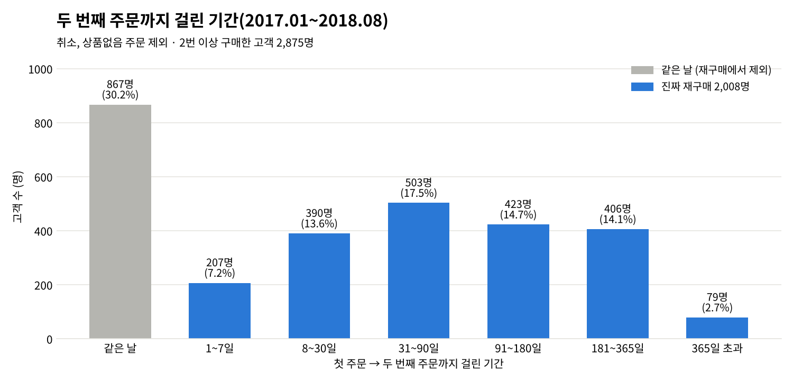

# 04. 재구매 분석

퍼널 분석에서 배송 지연이 리뷰 점수를 크게 떨어뜨리는 것을 확인했다. 그렇다면 첫 주문 배송 경험이 고객이 다시 사는지에도 영향을 줄지 궁금해 재구매를 살펴봤다.

## 같은 날 주문은 재구매가 아니었다

분석 기간에 2번 이상 구매한 고객은 2,875명으로 전체 고객의 3.0%였다. 그런데 첫 주문에서 두 번째 주문까지 걸린 기간을 보니 **같은 날**이 867명(30.2%)으로 가장 많았다.

같은 날 다시 주문한 고객을 자세히 보니 89.5%가 10분 안에, 96.2%가 1시간 안에 주문했다. 결제수단도 99.1%가 첫 주문과 같았다. 다른 날 다시 산 고객보다 같은 판매자(47.1% vs 25.2%), 같은 상품(23.8% vs 14.7%)을 포함한 경우도 많았다. 한 번의 쇼핑을 결제만 나눠서 한 것에 가깝다고 봤다.

왜 나눠서 결제했는지도 궁금했다. 데이터로 확정할 수는 없지만 몇 가지 단서가 있었다.

- 두 주문 모두 배송비가 붙었다. 같은 상품 2개를 한 번에 사도 배송비가 1.98배라, 합쳐서 주문할 이유가 크지 않다.
- 상품을 여러 개 산 주문의 87%가 판매자 1명의 상품만 담고 있었다. 판매자가 다른 상품은 한 주문으로 잘 묶이지 않는 구조로 보인다. 실제로 같은 날 재구매의 53%는 첫 주문과 다른 판매자의 상품이었다.
- 18.5%는 두 주문의 할부 개월을 다르게 설정했다.

그래서 첫 주문과 **다른 날** 다시 산 경우만 재구매로 봤다. 그러자 재구매 고객은 2,008명, 재구매율은 **2.1%**가 됐다. 이들이 다시 사기까지는 중앙값 75일이 걸렸다(하위 25% 23일, 상위 25% 175일).

## 모든 고객을 똑같이 180일씩 관찰했다

고객마다 관찰 기간이 다르면 늦게 처음 산 고객은 다시 살 시간이 부족해 재구매율이 낮게 나온다. 그래서 데이터가 끝나는 2018.08까지 180일을 모두 볼 수 있도록 **첫 주문이 2017.01~2018.02인 첫 구매 고객**만 대상으로 했다. 첫 주문 후 180일 안에 다른 날 다시 주문하면 재구매로 봤다.

배송 경험을 봐야 하므로 첫 주문이 배송 완료된 고객 55,227명을 대상으로 했고, 배송 기간을 계산할 때는 출고일까지 정상인 55,209명을 썼다. 이 고객들의 180일 재구매율은 2.0%(1,102명)였다.

## 배송이 오래 걸린 고객은 덜 돌아왔다

먼저 예상일보다 늦게 받은 고객이 덜 돌아오는지 봤다. 늦게 받은 고객의 재구매율은 1.61%로 제때 받은 고객(2.02%)보다 0.4%p 낮았지만, 통계적으로 유의하지는 않았다(p = 0.083). 늦게 받은 고객이 3,667명으로 적어서 차이를 확신하기 어려웠다.

그래서 지연 여부 대신 **실제로 얼마나 오래 걸렸는지**로 나눠 봤다. 첫 주문의 출고부터 도착까지 걸린 기간이 길수록 재구매율이 꾸준히 낮아졌다(추세 검정 p = 0.0002).

| 첫 주문 출고 → 도착 | 고객 수 | 재구매 | 재구매율 | 재구매까지 평균 |
|---|---:|---:|---:|---:|
| 0~3일 | 9,269 | 203 | 2.19% | 69일 |
| 4~7일 | 16,894 | 366 | 2.17% | 72일 |
| 8~14일 | 18,463 | 369 | 2.00% | 65일 |
| 15~21일 | 6,298 | 103 | 1.64% | 62일 |
| 22일 이상 | 4,285 | 61 | 1.42% | 78일 |

배송이 오래 걸리는 고객은 SP 밖에 많아서 지역 차이를 본 것일 수도 있었다. 그래서 권역, 첫 주문 배송비, 첫 구매 금액을 함께 넣은 로지스틱 회귀로 다시 확인했는데, 배송 기간은 여전히 재구매를 낮추는 쪽으로 유의했다(p = 0.0006). 다만 상품 종류처럼 데이터에 없는 요인이 섞였을 수 있어 인과관계로 단정하지는 않았다.

첫 주문 리뷰도 재구매와 연결됐다. 1~2점을 준 고객의 재구매율은 1.67%로 4~5점을 준 고객(2.06%)보다 낮았다(p = 0.031).

| 첫 주문 리뷰 | 고객 수 | 재구매 | 재구매율 |
|---|---:|---:|---:|
| 1~2점 | 7,182 | 120 | 1.67% |
| 3점 | 4,810 | 96 | 2.00% |
| 4~5점 | 42,826 | 881 | 2.06% |

## 배송비와 첫 구매 금액은 재구매와 관련이 없었다

배송비 부담이 크면 다시 사지 않을 것이라고 예상했다. 앞에서 본 것처럼 소액 주문은 배송비가 상품 금액의 절반에 가깝기 때문이다. 그런데 첫 주문의 배송비 비중이 높은 고객도 재구매율이 낮지 않았다(1.84~2.21%). 위의 회귀에서도 배송비는 오히려 높을수록 재구매가 조금 높은 쪽으로 나왔다. 재구매를 낮추는 것은 배송비가 아니라 배송 기간이었다.

배송비 비중별 재구매율

| 첫 주문 배송비 비중 | 고객 수 | 재구매율 | 평균 상품 금액 | 평균 배송비 |
|---|---:|---:|---:|---:|
| 10% 미만 | 10,312 | 1.94% | 343.4 | 20.1 |
| 10~20% | 20,541 | 2.03% | 124.5 | 20.9 |
| 20~30% | 13,315 | 1.84% | 74.2 | 23.5 |
| 30~40% | 6,432 | 2.21% | 44.7 | 23.2 |
| 40% 이상 | 4,609 | 2.15% | 25.8 | 24.5 |

첫 구매 금액도 마찬가지였다. 금액대별 재구매율은 1.44~2.25%로 통계적 차이가 없었다(p = 0.24). 재구매 고객의 두 번째 주문 금액은 중앙값 88헤알로 첫 주문(86헤알)과 비슷했다.

## 남동부가 가장 많이 돌아오고, 북동부가 가장 적게 돌아온다

| 권역 | 고객 수 | 첫 구매 금액(평균) | 재구매 | 재구매율 | 배송 기간(평균) |
|---|---:|---:|---:|---:|---:|
| 남동부 | 37,211 | 130.1 | 805 | 2.16% | 8.3일 |
| 중서부 | 3,268 | 150.7 | 65 | 1.99% | 12.8일 |
| 남부 | 8,171 | 132.3 | 135 | 1.65% | 11.8일 |
| 북부 | 1,126 | 178.0 | 18 | 1.60% | 19.1일 |
| 북동부 | 5,433 | 161.0 | 79 | 1.45% | 17.3일 |

권역 간 재구매율 차이는 유의했다(p = 0.0007). 배송이 오래 걸리는 북부·북동부가 대체로 낮았지만 예외도 있었다. 남부는 중서부보다 배송이 빠른데 재구매율은 더 낮았고, RJ는 배송이 SP의 2배 걸리는데 재구매율은 비슷했다(2.12% vs 2.24%). 배송 기간만으로 권역 차이를 모두 설명할 수는 없었다.

## 재구매는 첫 30일에 몰린다

쿠폰 같은 개입을 언제 하면 좋을지 알기 위해, 다시 사는 시점을 30일 단위로 나눠 봤다.

| 대상 | 1~30일 | 31~60일 | 61~90일 | 91~120일 | 121~150일 | 151~180일 |
|---|---:|---:|---:|---:|---:|---:|
| **전체** | **0.66%** | 0.37% | 0.29% | 0.25% | 0.22% | 0.21% |
| 남동부 | 0.72% | 0.40% | 0.32% | 0.26% | 0.24% | 0.23% |
| 중서부 | 0.64% | 0.40% | 0.24% | 0.21% | 0.28% | 0.21% |
| 남부 | 0.47% | 0.33% | 0.27% | 0.31% | 0.15% | 0.13% |
| 북동부 | 0.53% | 0.33% | 0.17% | 0.15% | 0.09% | 0.18% |
| 북부 | 0.62% | 0.18% | 0.09% | 0.09% | 0.36% | 0.27% |

*구간 재구매율 = 그 기간에 처음 다시 산 고객 ÷ 대상 고객*

180일 안에 다시 산 1,102명 중 362명(32.8%)이 첫 30일에 샀다. 모든 권역에서 첫 30일의 재구매가 가장 많았고, 31~60일부터 크게 줄었다. 재구매 시점은 권역 간에 통계적 차이가 없었다(p = 0.70). 쿠폰 시점은 권역마다 다르게 정할 필요 없이 공통으로 정해도 된다는 뜻이다.

재구매까지 걸린 기간의 중앙값은 권역별로 49~70일이었지만 통계적 차이는 없었고, 남동부 외 권역은 재구매 고객이 18~135명으로 적어 값이 불안정하다.

권역별 재구매까지 걸린 기간

| 권역 | 재구매 고객 | 재구매까지 평균 | 중앙값 |
|---|---:|---:|---:|
| 남동부 | 805 | 68.7일 | 59일 |
| 남부 | 135 | 70.5일 | 69일 |
| 중서부 | 65 | 69.1일 | 49일 |
| 북동부 | 79 | 62.7일 | 50일 |
| 북부 | 18 | 78.7일 | 69.5일 |

## 쿠폰 전략 세 가지

| 전략 | 대상 | 시점 | 목적 | 근거 |
|---|---|---|---|---|
| 1. 배송 직후 쿠폰 | 모든 첫 구매 고객 | 배송 완료 직후 (유효기간 30일) | 재구매율이 가장 높은 시기의 재구매 확대, 쿠폰 효과 검증 | 첫 30일 재구매율 0.66%로 가장 높음, 180일 재구매의 33%가 이 기간에 발생 |
| 2. 미재구매 고객 쿠폰 | 30일 안에 다시 사지 않은 고객 | 첫 구매 후 31일 | 30일 내 미구매 고객의 재구매 유도 (자발적 재구매 고객 할인 제외) | 30일 이후 구간별 재구매율 0.2~0.4%대, 남동부 31~180일 재구매율 1.46% |
| 3. 배송 지연 보상 쿠폰 | 첫 주문이 예상일보다 늦게 온 고객 | 배송 완료 직후 | 불만 완화, 1~2점 리뷰 감소 | 지연 주문은 6.7%지만 1~2점 리뷰의 32.6%, 1~2점 고객 재구매율 1.67% (4~5점 2.06%) |

- **배송 직후 쿠폰부터 검증한다.** 대상이 가장 많아 실험하기 좋고, "쿠폰이 재구매를 늘리는가"를 먼저 확인해야 나머지 전략의 시행 여부를 정할 수 있다.
- **지연 고객은 별도로 대응한다.** 예상일을 넘길 것으로 보이는 주문은 미리 안내하고, 늦게 받은 고객에게는 배송 직후 쿠폰 대신 보상 쿠폰을 보낸다. 지연 비율이 높은 RJ부터 적용한다.
- **첫 구매 금액으로 대상을 나누지 않는다.** 첫 구매 금액과 재구매는 관련이 없었다(p = 0.24).
- **쿠폰 조건은 100헤알 이상 구매로 정했다.** 조건이 낮으면 원래 재구매할 고객도 쿠폰을 써서 할인 비용이 커지고(50헤알 이상이면 30일 재구매 주문의 67.2%가 사용 가능), 높으면 쓸 수 있는 고객이 적어 효과를 확인하기 어렵다(200헤알 이상이면 13.1%). 그 사이인 100헤알(40.1%)을 기준으로 했다. 근거 계산은 [06. 쿠폰 사업성 검증](06_business_case.md)에 정리했다.

## 정리

- 재구매는 정의부터 중요했다. 같은 날 주문을 빼자 재구매율이 3.0%에서 2.1%로 바뀌었다.
- 첫 주문 배송이 오래 걸리거나 첫 리뷰가 나쁜 고객이 덜 돌아왔다. 배송비와 구매 금액은 관련이 없었다.
- 재구매는 **첫 30일**에 가장 많다. 배송 직후 30일 쿠폰이 효과가 있는지 확인하기 위해 [A/B 테스트를 설계](05_ab_test_design.md)했다.

📎 코드: [`sql/04_repurchase/`](../sql/04_repurchase/) (13 재구매, 21 같은 날 재구매, 23 재구매 패턴), [`sql/06_business_case/`](../sql/06_business_case/) (쿠폰 조건), [`python/stats_tests.py`](../python/stats_tests.py)
