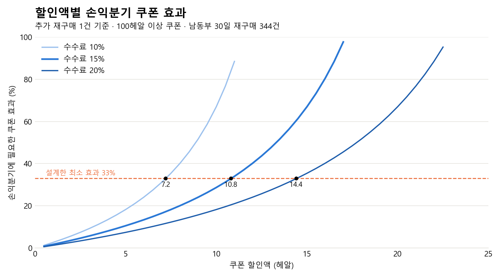

# 06. 쿠폰 사업성 검증

A/B 테스트는 쿠폰이 30일 이내 재구매율을 높이는지를 확인한다. 하지만 재구매가 늘어도 할인 비용이 더 크면 쿠폰을 확대할 이유가 없다. 그래서 추가 재구매 1건 기준으로 쿠폰의 손익을 계산하고, 실험 결과를 보고 확대 여부를 판단할 기준을 미리 정했다.

## 비용과 수익을 어떻게 잡았나

쿠폰 비용은 늘어난 재구매에서만 생기지 않는다. 쿠폰이 없어도 다시 샀을 고객도 쿠폰을 쓰기 때문이다. 반대로 Olist의 수익은 추가 재구매의 거래액 전체가 아니라 판매자에게 받는 수수료다.

| 구분 | 내용 |
|---|---|
| 비용 | 원래 재구매할 고객의 할인 + 추가 재구매 고객의 할인 |
| 수익 | 추가 재구매 주문의 수수료 |
| 할인액 | 가정값 (실험으로 정할 수 없음) |
| 수수료율 | 가정값 15% (10%, 20%도 함께 계산, 근거는 아래) |

## 수수료율 가정: 경쟁사 수수료의 중간인 15%

데이터에는 Olist가 판매자에게 받는 수수료가 없다. 그래서 브라질 주요 마켓플레이스의 판매 수수료를 참고해 가정했다. 여기서 판매 수수료는 판매자가 판매 금액의 일정 비율을 마켓플레이스에 내는 수수료다.

| 마켓플레이스 | 판매 수수료 | 출처 |
|---|---|---|
| Mercado Livre | Clássico 10~14% · Premium 15~19% | [E-commerce na Prática (2026.07)](https://ecommercenapratica.com/quanto-custa-vender-no-mercado-livre/) |
| Amazon Brasil | 10~15% (카테고리별) | [Rua CEP (2026.05)](https://www.ruacep.com.br/guias/ecommerce/comissao-marketplace-ml-amazon-shopee-magalu-2026/) |
| Shopee | 14~20% + 건당 고정 수수료 | [Rua CEP (2026.05)](https://www.ruacep.com.br/guias/ecommerce/comissao-marketplace-ml-amazon-shopee-magalu-2026/) |

세 곳의 수수료는 10~20% 범위에 있다. 이 범위의 중간인 15%를 기준으로 삼고, 범위의 최저·최고인 10%와 20%도 함께 계산했다. 수수료가 낮을수록 최대 할인액이 줄어든다(효과 33% 기준 10% 7.2헤알, 20% 14.4헤알).

수수료가 높을수록 최대 할인액은 커지지만 판매자가 이탈할 위험도 커진다. 예를 들어 Magalu는 2026년 신규 판매자 수수료를 절반으로 낮춰 판매자 유치에 나섰다([Mercado & Consumo (2026.02)](https://mercadoeconsumo.com.br/25/02/2026/ecommerce/magalu-reduz-taxa-pela-metade-para-atrair-novos-vendedores/)). 그래서 수수료를 올려 할인 폭을 키우기보다 수수료는 그대로 두고 할인 상한(10.8헤알)을 관리하는 방향으로 판단했다.

> 수수료는 2026년 기준이라 데이터 시점(2016~2018년)과 다르다. 판매자 측 데이터(입점·이탈)가 없어 적정 수수료 수준 자체는 판단하지 않았다.

## 쿠폰 조건: 100헤알 이상

실험 대상(남동부 첫 구매 고객 58,071명)에서 배송 후 30일 이내에 재구매한 주문 344건의 금액을 봤다. 최소 주문 금액에 따라 원래 재구매할 고객 중 쿠폰을 쓸 수 있는 비중, 즉 할인 비용이 생기는 비중이 달라진다.

| 쿠폰 조건 | 30일 이내 재구매 중 사용 가능 비중 | 판단 |
|---|---:|---|
| 조건 없음 | 100% | 원래 재구매할 고객 전원에게 할인 비용 발생 |
| 50헤알 이상 | 67.2% | 할인 비용이 큼 |
| **100헤알 이상** | **40.1%** | 비용과 효과 확인 사이의 기준 |
| 200헤알 이상 | 13.1% | 쓸 수 있는 고객이 적어 효과 확인이 어려움 |

100헤알 이상 재구매 주문 138건의 금액 중앙값은 159.9헤알이다. 추가 재구매 1건의 주문 금액은 이 값으로 가정했다.

## 손익분기 효과

배송 후 30일 이내 재구매율을 p, 쿠폰 효과(재구매율 상승률)를 e, 할인액을 d, 수수료율을 c라고 하면 고객 1명당

- 비용 = p × 0.401 × d (원래 재구매) + p × e × d (추가 재구매)
- 수익 = p × e × 159.9 × c

비용과 수익이 같아지는 효과가 손익분기 효과다.

> **손익분기 효과 = 0.401 × d ÷ (159.9 × c − d)**
>
> 0.401: 30일 이내 재구매 중 100헤알 이상 주문 비중 / 159.9: 해당 주문 금액 중앙값(헤알)

## 결과

설계한 최소 효과 33%에서 손해가 없는 최대 할인액은 수수료 15%일 때 **10.8헤알**이다.

| 수수료율 | 효과 33%에서 손해가 없는 최대 할인액 |
|---|---:|
| 10% | 7.2헤알 |
| **15%** | **10.8헤알** |
| 20% | 14.4헤알 |

Olist의 수익은 거래액이 아니라 수수료라서, 쿠폰 손익은 수수료 기준으로 판단해야 한다.

## 확대 판단 기준 (수수료 15% 가정)

| 할인액 | 손익분기 효과 |
|---|---:|
| 4헤알 | 8.0% |
| 6헤알 | 13.4% |
| 8헤알 | 20.1% |
| 10헤알 | 28.7% |

실험에서 측정한 효과가 손익분기 효과를 넘는 할인액까지만 적용한다. 예를 들어 측정한 효과가 25%라면 손익분기 효과가 20.1%인 8헤알까지 적용할 수 있다.

## 한계

- 할인액과 수수료율은 가정값이다. 실제 수수료율과 쿠폰 비용 분담 방식에 따라 결과가 달라진다.
- 쿠폰 효과(33%)는 할인액과 관계없이 같다고 가정했다. 실제로는 할인액이 클수록 효과도 커질 수 있다.
- 추가 재구매 주문 금액을 100헤알 이상 재구매의 중앙값으로 가정했다. 쿠폰 때문에 금액을 맞춰 산 주문은 이보다 작을 수 있다.
- 효과가 확인되더라도 30일 이내 재구매율이 0.592%로 낮아, 늘어나는 재구매의 절대 규모는 작다.
- 판매자 측 데이터(입점·이탈)가 없어 적정 수수료는 판단하지 못한다.

## 다음 단계

1. 실험을 실행해 측정한 효과를 손익분기 효과와 비교하고 확대 여부를 결정한다.
2. 쿠폰 최소 주문 금액별 비교 실험으로 100헤알 기준이 적정한지 확인한다.
3. RJ 장기 배송의 원인을 판매자 위치·상품군별로 분석한다.

📎 코드: [`sql/06_business_case/40_repurchase_30d_amount.sql`](../sql/06_business_case/40_repurchase_30d_amount.sql), [`python/breakeven.py`](../python/breakeven.py)
